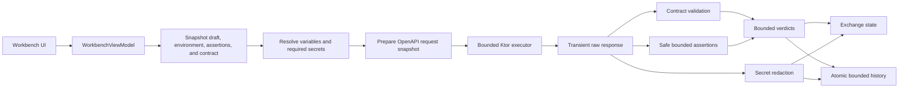

# Architecture

PostSync Pro uses MVVM and explicit domain boundaries. UI state is exposed as immutable `StateFlow`; file, network, parsing, and cryptographic work is kept out of composables and dispatched away from the UI thread.

## Contract-aware execution pipeline

The raw response exists only long enough to validate the selected contract operation and evaluate the snapshotted assertions. It must never be placed in UI state, logs, exports, or history. Display and persistence receive a separate redacted response; assertion results contain bounded generic diagnostics rather than actual or expected values. An execution snapshot binds the draft, resolved environment values, assertions, selected operation, result, verdicts, and history outcome so edits cannot relabel an in-flight response.

## Workbench v2 local storage

Workbench v2 uses two independent repository boundaries in addition to bounded history:

- `FileWorkbenchEnvironmentRepository` stores named variable sets and the active environment ID. Secret variable values are AES-256-GCM ciphertext; non-secret values and metadata are not encrypted. If one secret cannot decrypt, that value is withheld and marked for explicit restoration while unrelated variables remain available. Selecting or updating the degraded environment preserves the existing ciphertext rather than persisting an empty replacement.
- `FileWorkbenchSavedRequestRepository` stores collections, folders, and sanitized reusable requests. Authentication credentials, secret variables, sensitive headers/query/body/URL data, and sensitive assertion operands are stripped before serialization. Safe `requiredSecrets` metadata records what must be restored without storing the omitted value.
- `SecureAtomicWorkbenchFile` provides a per-path mutex plus a sibling OS file lock, file-size limits, symlink rejection, private permissions where the platform supports them, forced same-directory temporary writes, and fail-closed atomic replacement.

A missing store is a valid empty workspace. A present store with invalid size, JSON, version, IDs, hierarchy, or bounds raises `WorkbenchStorageCorruptionException`. Ordinary upserts and deletes read first, so they fail without replacing corrupt bytes. The explicit recovery path moves the untouched bytes to a uniquely named sibling `.corrupt-…bak` file before publishing an empty valid envelope; a reset failure attempts to restore the original. No automatic repair is claimed.

## Layers

- `presentation/`: Compose screens, navigation, localized strings, themes, and view models.
- `domain/`: models, repository contracts, variable resolution, contract preparation and validation, and redaction policies.
- `data/`: Ktor execution, bounded parsers, persistent repositories, SQLite, encryption, and download implementations.
- `di/`: Koin ownership and lifecycle for clients, repositories, use cases, and view models.

The Workbench entry points are:

- `WorkbenchModels.kt`: request, response, contract, history, and execution state.
- `WorkbenchStorageModels.kt`: named environments, collection/folder/request records, and safe secret-restoration metadata.
- `WorkbenchAssertions.kt`: serializable declarative checks and redacted result models.
- `WorkbenchRepositories.kt`: executor and history boundaries.
- `WorkbenchStorageRepositories.kt`: environment and saved-workspace repository contracts, including corruption semantics.
- `ResolveWorkbenchVariablesUseCase.kt`: nested environment expansion and required-secret checks.
- `PrepareContractRequestUseCase.kt`: OpenAPI operation to request draft.
- `ValidateContractResponseUseCase.kt`: status, media type, and bounded schema validation.
- `EvaluateWorkbenchAssertionsUseCase.kt`: cancellable status/time/header/body/JSON checks with input, nesting, and path budgets.
- `KtorWorkbenchRequestRepository.kt`: cancellation, timeout, header validation, and bounded streaming capture.
- `FileWorkbenchHistoryRepository.kt`: sanitized, capacity-limited, atomic local history.
- `FileWorkbenchEnvironmentRepository.kt`: encrypted-at-rest secret variables and persistent environment selection.
- `FileWorkbenchSavedRequestRepository.kt`: collection hierarchy, search, request sanitation, and restoration markers.
- `SecureAtomicWorkbenchFile.kt`: shared fail-safe file publication boundary for the v2 stores.

## Compatibility rule

Existing Sync, Validator, Fuzz, Mock Server, Test Chain, reporting, and analysis flows remain independent while the shared executor matures. Migration must happen adapter by adapter behind contract tests; a feature is not considered migrated until its legacy fixtures and cancellation behavior still pass.

OpenAPI security semantics are intentional: a `null` operation security declaration inherits the root declaration, while `security: []` explicitly disables authentication.

## Resource and lifecycle rules

- Network and file inputs have explicit size limits; large response UI uses a virtualized preview.
- Assertion runs cap count, response/header input, expected-value size, JSON depth/tokens, and JSON-path length/segments. Containment uses linear-time matching; executable scripts, regular-expression assertions, JSONPath filters, wildcards, and recursive descent are outside this evaluator.
- Fuzz work uses bounded workers, and cancellation belongs to a run rather than a process-wide poison flag.
- Koin owns shared HTTP clients and closes them during application shutdown.
- View models cancel their jobs and release owned resources when their composition lifetime ends.
- Settings, history, Workbench v2 stores, keys, and verified downloads publish through same-directory temporary files. Workbench v2 stores fail closed when atomic replacement is unavailable and serialize cross-process mutations with OS locks.

See [SECURITY.md](SECURITY.md) for the full security posture and [ROADMAP.md](ROADMAP.md) for the next architectural slices.
